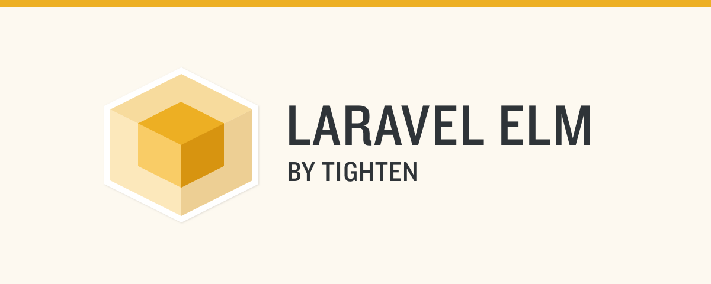

<hr>

[](https://packagist.org/packages/loganhenson/laravel-elm)
[](https://github.com/loganhenson/laravel-elm/actions/workflows/run-tests.yml)

# A Platform for Elm on Laravel

Tired of the paradox of choice and constant churn on the frontend?

Want a stable and opinionated platform to build on?

This package makes it seamless.

## Requirements

-   Laravel 13.x
-   PHP 8.4+
-   Node.js 20.19+ with Vite 7 or 8 (Laravel 13 ships Vite 8; `vite-plus` is supported too)
-   Elm 0.19.3 (installed for you by the `laravel-elm` npm package)
-   Tailwind CSS 4.3+ for the scaffolded pages (optional, see [Tailwind alongside existing CSS](#tailwind-alongside-existing-css))

## Docs

-   [Installation (new app)](#installation-new-app)
-   [Adding to an existing app](#adding-to-an-existing-app)
    -   [Alongside React, Vue or Svelte (Inertia)](#alongside-react-vue-or-svelte-inertia)
    -   [Alongside Livewire, Alpine or Blade](#alongside-livewire-alpine-or-blade)
    -   [Alongside Angular or any separately built SPA](#alongside-angular-or-any-separately-built-spa)
    -   [Tailwind alongside existing CSS](#tailwind-alongside-existing-css)
-   [Upgrading](#upgrading)
-   [Creating a page](#creating-a-page)

> Some Elm knowledge required from here on!
>
> [Elm learning resources](#some-elm-knowledge-required-from-here-on)

-   [Pass values to your page](#pass-values-to-your-page)
-   [Share values with all your pages](#share-values-with-all-your-pages)
-   [Routing](#routing)
-   [Validation errors](#validation-errors)
-   [Interop with Javascript](#interop-with-javascript)
-   [Persistent scroll](#persistent-scroll)
-   [Progress indicators](#progress-indicators)
-   [Debugging](#debugging)
-   [Deploying](#deploying)
-   [Configuration](#configuration)
-   [Commands](#commands)
-   [Testing](#testing)
-   [Example apps](#example-apps)

## Installation (new app)

1. Create a Laravel 13 app (see https://laravel.com/docs/installation) and `cd` into it

```bash
laravel new my-app
cd my-app
```

2. Add the package

```bash
composer require loganhenson/laravel-elm
```

3. Install Laravel Elm

```bash
php artisan elm:install
```

> `elm:install` only adds what is missing, it never throws away your config:
>
> -   **`package.json`**: adds `laravel-elm` (and, when your app uses Tailwind 4 or has no Vite config yet,
>     `tailwindcss` / `@tailwindcss/vite` `^4.3`, `vite` `^8`, `laravel-vite-plugin` `^3.1`). Existing versions
>     are only bumped within their major version.
> -   **`vite.config.js` / `.ts`**: adds `import laravelElm from 'laravel-elm'`, the `laravelElm()` plugin and the
>     `resources/js/elm.js` entry (your fonts, plugins and other options are kept).
> -   **`resources/css/app.css`**: adds `@source '../elm/**/*.elm';` so Tailwind sees the classes in your Elm pages.
> -   **`resources/views/app.blade.php`**: created if missing; this is the Blade view Elm pages render into.
> -   **`resources/elm/`**: `elm.json` (Elm 0.19.3) and the `LaravelElm` support module.
> -   **`.gitignore`**: ignores `resources/js/elm.js`, which the Vite plugin generates.

4. Install the npm dependencies

```bash
npm install
```

> This also installs the Elm compiler for your platform (macOS, Linux and Windows; x64 and arm64).
> npm 12 may warn that `elm`'s install script was blocked: that's harmless, the compiler still runs
> (`npm install-scripts approve elm` silences it).

5. Create a page, or scaffold authentication

```bash
php artisan elm:create Welcome
```

> Then render it from a route, see [Creating a page](#creating-a-page).

**Or**, for a complete login / registration / password reset / email verification setup (Tailwind styled):

```bash
php artisan elm:auth
php artisan migrate
```

> `elm:auth` adds the Elm pages and controllers, a `Home` page with a log out button, and
> `Elm::authRoutes()` (plus the `/home` route) to `routes/web.php`. Only use it in an app that doesn't
> already have authentication (e.g. not on top of a starter kit's Fortify auth).

6. Run it

```bash
composer run dev
```

> This starts `php artisan serve` (http://localhost:8000) and `npm run dev` (Vite + Elm compilation +
> hot reloading) together. Using Herd or Valet? Just run `npm run dev`.
>
> Try `/register`, `/login`, or the page you created!

## Adding to an existing app

The steps are the same as for a [new app](#installation-new-app): `composer require loganhenson/laravel-elm`,
`php artisan elm:install`, `npm install`, then `php artisan elm:create SomePage`.

`elm:install` is built to be run on an existing app:

-   It edits your `vite.config.js`/`.ts` in place (including `vite-plus` configs using
    `plugins: lazyPlugins(() => [...])`, whose `lint`/`fmt` `ignorePatterns` also get the generated files).
    If it can't recognise your config it changes nothing and prints the three lines to add:

```javascript
import laravelElm from 'laravel-elm';

// ...
plugins: [
    laravelElm(),
    laravel({ input: [/* your entries */, 'resources/js/elm.js'] }),
    // ...your other plugins
],
```

-   If `resources/views/app.blade.php` already exists for something else (an Inertia root view, your main
    layout...), it is **left alone**: Elm pages get their own `resources/views/elm.blade.php`, and
    `config/elm.php` is published with `'root_view' => 'elm'`. Customize that view freely (add your
    favicon, fonts, a dark mode class...), it just needs to keep the `@elm` directive inside `<body>`.
-   Tailwind 3 or no Tailwind at all: it doesn't install or change Tailwind, see
    [Tailwind alongside existing CSS](#tailwind-alongside-existing-css).
-   Don't run `elm:auth` if your app already has authentication; build your Elm pages with `elm:create`
    and pass the current user to them with [`Elm::share`](#share-values-with-all-your-pages).

How Laravel Elm coexists with everything else:

-   Elm pages are ordinary Laravel routes that `return Elm::render('Page')`. Everything else in your app is
    untouched.
-   The Laravel Elm middleware only acts on requests sent by Laravel Elm itself (the `X-Laravel-Elm`
    header), so Inertia, Livewire and API requests pass straight through.
-   Each Elm page renders into the root view (`config('elm.root_view')`), which loads only the assets you
    list in it plus `resources/js/elm.js` (`@elm`). The current Elm page mounts in a `<div id="app">`
    appended to `<body>`, so don't load another framework that mounts onto `#app` in that view.
-   Laravel Elm uses Laravel's normal session, CSRF (`XSRF-TOKEN` cookie) and auth, shared with the rest of
    your app.

### Alongside React, Vue or Svelte (Inertia)

Tested with the Laravel 13 React starter kit (Inertia, React 19, TypeScript, `vite-plus`, Tailwind 4):

```bash
composer require loganhenson/laravel-elm
php artisan elm:install
npm install
php artisan elm:create Reports
```

```php
// routes/web.php
use LoganHenson\Elm\Elm;

Route::get('/reports', fn () => Elm::render('Reports'))->middleware('auth')->name('reports');
```

```bash
php artisan elm:routes
```

-   Your Inertia `app.blade.php` stays as it is; Elm pages render into `resources/views/elm.blade.php`,
    which loads your `resources/css/app.css` (so they share your Tailwind theme) but not your
    `app.tsx`/`app.ts`.
-   Navigating **from Inertia to Elm**: `<Link href="/reports">` and `router.visit('/reports')` work; Laravel
    Elm answers Inertia's request with a `409` + `X-Inertia-Location` (like `Inertia::location()`), so Inertia
    does a full page visit to the Elm page.
-   Navigating **from Elm to Inertia**: `Routes.get Routes.dashboard` (or any non Elm URL) does a full page
    load of that page.
-   `npm run check` / `vp check` keep passing: `resources/js/elm.js` and `resources/elm/**` are added to
    the `lint` and `fmt` ignore lists. With a separate ESLint/Prettier setup, add `resources/js/elm.js`
    to your ignores (`.prettierignore` is updated automatically when it exists).

### Alongside Livewire, Alpine or Blade

Tested with the Laravel 13 Livewire starter kit. There is no conflict to resolve: Blade and Livewire pages
keep their layouts, Elm pages use the root view. If you want Alpine (or any small script) on your Elm
pages too, add its entry to the root view's `@vite([...])`; keep it away from the `#app` element Elm owns.

### Alongside Angular or any separately built SPA

Angular (Angular CLI) and similar SPAs are built by their own tooling rather than Vite, and are usually
served from their own path, e.g. a catch-all route returning the SPA's `index.html`:

```php
// routes/web.php — register your Elm routes BEFORE the SPA catch-all
Route::get('/reports', fn () => Elm::render('Reports'));

Route::view('/app/{any?}', 'angular')->where('any', '.*');
```

-   Keep the SPA's catch-all from swallowing your Elm routes (register Elm routes first, or scope the
    catch-all to a prefix like `/app`).
-   Move between the SPA and Elm pages with normal links (full page loads); both share the same Laravel
    session and auth.
-   If your SPA is built with Vite (e.g. Analog, Vue, Svelte, Solid without Inertia), add `laravelElm()` and
    `resources/js/elm.js` to that Vite config like any other entry.

### Tailwind alongside existing CSS

The scaffolded pages (`elm:auth`, `elm:create`) use Tailwind 4 classes. Pick the setup that fits your app:

**Your app already uses Tailwind 4**: nothing to do, `elm:install` added `@source '../elm/**/*.elm';`.

**Your app uses Tailwind 3**: add your Elm files to `content` in `tailwind.config.js` (the root view loads
your `resources/css/app.css`):

```javascript
content: [
    // ...
    './resources/elm/**/*.elm',
],
```

**Your app has other CSS (Bootstrap, Bulma, your own...) and no Tailwind.** First add Tailwind:

```bash
npm install --save-dev tailwindcss@^4.3 @tailwindcss/vite@^4.3
```

```javascript
// vite.config.js
import tailwindcss from '@tailwindcss/vite';
// ...
plugins: [laravelElm(), tailwindcss(), laravel({ /* ... */ })],
```

then either:

_A) Give Elm pages their own stylesheet (recommended, nothing can clash)._ Create `resources/css/elm.css`:

```css
@import 'tailwindcss';

@source '../elm/**/*.elm';
```

add `'resources/css/elm.css'` to the `input` array in `vite.config.js`, and load **only** it in your Elm
root view: `@vite(['resources/css/elm.css'])`.

_B) Use Tailwind on the same pages as your existing CSS: prefix it and skip its reset._ Create
`resources/css/elm.css`:

```css
/*
 * - prefix(tw):    classes are tw:flex, tw:hover:bg-blue-600, tw:md:p-8 ... (no clashes with your class names)
 * - no preflight:  Tailwind's reset is not loaded, so it doesn't restyle the rest of the page
 * - no layer(...): utilities stay unlayered, so they win over your (unlayered) CSS by normal specificity
 *                  and order. Layered rules always lose to unlayered ones.
 */
@import 'tailwindcss/theme.css' prefix(tw);
@import 'tailwindcss/utilities.css' prefix(tw);

@source '../elm/**/*.elm';
```

add `'resources/css/elm.css'` to `input` in `vite.config.js`, and load it **after** your existing CSS in the
root view:

```blade
@vite(['resources/css/app.css', 'resources/css/elm.css'])
```

Then mix both freely in Elm:

```elm
button [ class "btn btn-primary tw:ml-4 tw:hover:opacity-50" ] [ text "Save" ]
```

> With the prefix, every Tailwind class needs it (variants go after it: `tw:md:hover:underline`), so the
> unprefixed classes in the `elm:auth` pages won't apply until you prefix them.

## Upgrading

### From 6.0

-   `composer update loganhenson/laravel-elm` and `npm install --save-dev laravel-elm@^4.1.1`
-   Regenerate your routes: `php artisan elm:routes` (route helpers now return absolute paths such as
    `"/password/email"`; before they were relative, which broke posting from nested URLs). If you worked
    around that by prefixing helpers yourself (`"/" ++ Routes.foodsEdit id`), remove the prefix, otherwise
    the URL becomes `//foods/...`.
-   Use Elm 0.19.3: set `"elm-version": "0.19.3"` in `resources/elm/elm.json` (no code changes needed)

### From tightenco/laravel-elm

`tightenco/laravel-elm` is abandoned; this package is its continuation (same author, same repo).

-   Swap the package:

```bash
composer remove tightenco/laravel-elm
composer require loganhenson/laravel-elm
```

-   Rename the PHP namespace `Tightenco\Elm` to `LoganHenson\Elm` in your app, e.g.

```bash
grep -rl 'Tightenco\\Elm' app routes tests | xargs sed -i.bak 's/Tightenco\\Elm/LoganHenson\\Elm/g'
```

> (the `Elm` facade alias is unchanged, so `Elm::render(...)` in routes keeps working)

-   Then follow [From 6.0](#from-60) above. Requirements are now Laravel 13 and PHP 8.4+.

## Creating a page

```bash
php artisan elm:create Welcome
```

> _this creates `resources/elm/pages/Welcome.elm`_ (`elm:create Admin.Users` creates
> `resources/elm/pages/Admin/Users.elm`, rendered as `Elm::render('Admin.Users')`)

Now use the `Elm` facade to render your Elm Page!

> `routes/web.php`

```php
Route::get('/', function () {
    return Elm::render('Welcome');
});
```

> Hello, Welcome.

# Some Elm knowledge required from here on

> Learning resources

-   https://guide.elm-lang.org/

## Pass values to your page

> Update your Laravel route:
>
> `routes/web.php`

```php
Route::get('/', function () {
    return Elm::render('Welcome', ['name' => 'John']);
});
```

> Update your Elm page:
>
> `resources/elm/pages/Welcome.elm`

-   add imports for decoding to the top
-   add the `name` field to `Props` (`String`)
-   update `decodeProps` with the `name` field
-   use `props.name` in your `view` function

```elm
module Welcome exposing (..)

import Html exposing (Html, div, text)
import Html.Attributes exposing (class)
import Json.Decode exposing (Decoder, Value, decodeValue, string, succeed)
import Json.Decode.Pipeline exposing (required)
import LaravelElm exposing (Page, page)


type alias Props =
    { name : String }


type alias State =
    {}


type alias Model =
    { props : Props
    , state : State
    }


type Msg
    = NewProps Value
    | NoOp


decodeProps : Decoder Props
decodeProps =
    succeed Props
        |> required "name" string


stateFromProps : Props -> State
stateFromProps props =
    {}


main : Page Model Msg
main =
    page
        { decodeProps = decodeProps
        , stateFromProps = stateFromProps
        , update = update
        , view = view
        , newPropsMsg = NewProps
        }


update : Msg -> Model -> ( Model, Cmd Msg )
update msg { props, state } =
    case msg of
        NewProps newProps ->
            ( { props = Result.withDefault props (decodeValue decodeProps newProps)
              , state = state
              }
            , Cmd.none
            )

        NoOp ->
            ( { props = props
              , state = state
              }
            , Cmd.none
            )


view : Model -> Html Msg
view { props, state } =
    div [ class "container mx-auto m-4 p-4" ]
        [ text <| "Hello, " ++ props.name ++ "!" ]
```

## Share values with all your pages

`app/Providers/AppServiceProvider.php`

```php
use LoganHenson\Elm\Elm;
...
    public function boot(): void
    {
        ...

        Elm::share('user', function () {
            return auth()->user() ? [
                'id' => auth()->user()->id,
                'name' => auth()->user()->name,
            ] : null;
        });
    }
...
```

> Every page then receives a `user` prop (decode it with `nullable` in pages that use it).

## Routing

Routing in Laravel Elm is handled completely by your Laravel routes!

However, we can _use_ those routes in our Elm code in a built in way.

1. Add a route, for example, our Welcome page, with a `name`:

```php
Route::get('/', function () {
    return Elm::render('Welcome');
})->name('welcome');
```

2. Run the `elm:routes` command to generate the Elm routes file (run it again whenever your named routes change)
    > `resources/elm/laravel-elm-stuff/Routes.elm` (don't edit this manually)

```bash
php artisan elm:routes
```

> Each named route becomes a function returning its path: `Routes.welcome` is `"/"`, and a route with
> parameters such as `password/reset/{token}` becomes `Routes.passwordReset : String -> String`.

3. Now we can send users to this page from Elm in our `update` handlers (with `import Routes`):
    > Send the user to `/`

```elm
Routes.get Routes.welcome
```

> Or even post some data to an endpoint:
>
> `POST /todos` with the `"description"` of `"add more docs"` (with `import Json.Encode`)

```elm
Routes.post <|
    Json.Encode.object
        [ ( "url", Json.Encode.string Routes.todosStore )
        , ( "data"
          , Json.Encode.object
                [ ( "description", Json.Encode.string "add more docs" )
                ]
          )
        ]
```

> `Routes.patch` takes the same shape, `Routes.delete` takes a url. A request to a route that doesn't
> return an Elm page (a Blade page, an Inertia page...) does a normal full page load of it.

## Validation errors

> The `errors` value is automatically passed to your Elm views, all you need to do is add it to your props to use it!

```elm
import Json.Decode exposing (Decoder, succeed)
import Json.Decode.Pipeline exposing (required)
import LaravelElm exposing (Errors, decodeErrors)


type alias Props =
    { errors : Errors }


decodeProps : Decoder Props
decodeProps =
    succeed Props
        |> required "errors" decodeErrors
```

> `Errors` is a `Dict String (List String)` of the messages for each field, e.g.
> `Dict.get "email" props.errors`. When a request fails validation, only the `errors` prop is updated
> (your page state is kept).

## Interop with Javascript

> Talk back and forth from JS & Elm
>
> `resources/elm/pages/ExamplePage.elm`

```elm
port module ExamplePage exposing (..)

port saveEmail : String -> Cmd msg

port receiveEmail : (Value -> msg) -> Sub msg
...
```

> In a script loaded by your Elm root view, e.g. `resources/js/app.js` (which the default `app.blade.php`
> loads; in an `elm.blade.php` add your script to its `@vite([...])`):

```js
LaravelElm.register('ExamplePage', (page) => {
    page.send('receiveEmail', localStorage.getItem('email'));

    page.subscribe('saveEmail', (email) => {
        localStorage.setItem('email', email);
    });
});
```

> `register` runs your callback every time a page whose name starts with the given name is mounted
> (`'*'` for every page). Subscribe to a page's ports with `subscribe` and send to them with `send`.

## Persistent scroll

> Sometimes you want an "app like" preservation of scroll positions while navigating to and from different pages.

Laravel Elm has built in support for this, by saving the viewport values into the history.

To use it you need to:

-   Import the components we need

```elm
import LaravelElm exposing (Page, Scroll, Viewports, decodeViewports, preserveScroll, receiveNewProps, saveScroll, setViewports)
```

-   Add a `SaveScroll` msg

```elm
type Msg
    = NewProps Value
    | NoOp
    | SaveScroll Scroll
```

-   Add the `viewports` prop

```elm
type alias Props =
    { viewports : Viewports }
```

-   Add the decoder for the `viewports` prop

```elm
decodeProps : Decoder Props
decodeProps =
    succeed Props
        |> required "viewports" decodeViewports
```

-   Make sure we are using the saved viewport positions on mount

```elm
main : Page Model Msg
main =
    LaravelElm.pageWithMountAndSubscriptions
        { decodeProps = decodeProps
        , stateFromProps = stateFromProps
        , view = view
        , update = update
        , subscriptions = \_ -> receiveNewProps NewProps
        , onMount = \props -> setViewports NoOp props.viewports
        }
```

-   Make sure we are using the saved viewport positions on update
-   As well as saving the viewport positions on scroll

```elm
update : Msg -> Model -> ( Model, Cmd Msg )
update msg { props, state } =
    case msg of
        NewProps newProps ->
            case decodeValue decodeProps newProps of
                Ok decodedProps ->
                    ( { props = decodedProps
                      , state = state
                      }
                    , setViewports NoOp decodedProps.viewports
                    )

                Err _ ->
                    ( { props = props, state = state }, Cmd.none )

        NoOp ->
            ( { props = props, state = state }, Cmd.none )

        SaveScroll scroll ->
            ( { props = props, state = state }, saveScroll scroll )
```

-   Finally, use `preserveScroll` on our html element ("key" should be unique for multiple scroll containers)

```elm
view : Model -> Html Msg
view { props, state } =
    div
        ([ class "h-full overflow-y-scroll" ]
            ++ preserveScroll SaveScroll "key"
        )
        [ text "long content" ]
```

## Progress indicators

### In Elm

> The `loading` prop is automatically passed to all your Elm views, you only
> need to add it to your props to use it!

```elm
type alias Props =
    { loading : Bool }

decodeProps : Decoder Props
decodeProps =
    succeed Props
        |> required "loading" bool
```

### In Javascript

> You can access the loading state in javascript via the `elm-loading` event
>
> Example using nprogress (`npm install nprogress`) to show a top progress bar:
>
> (after 180ms, so it does not appear for fast connections)

```js
import Nprogress from 'nprogress';
import 'nprogress/nprogress.css';

let loadingTimeout = null;
Nprogress.configure({ showSpinner: false, minimum: 0.4 });
window.addEventListener('elm-loading', function ({ detail: loading }) {
    clearTimeout(loadingTimeout);

    if (loading) {
        loadingTimeout = setTimeout(Nprogress.start, 180);
    } else {
        Nprogress.done();
    }
});
```

## Debugging

> With `APP_DEBUG=true` (or `ELM_DEBUG=true`):
>
> -   Laravel errors from Elm requests are shown in a modal with Laravel's usual error page.
> -   `dd()` output from Elm requests is shown in a modal too.
> -   While `npm run dev` is running, saving an Elm file recompiles it and reloads the page automatically
>     (compile errors are printed in the `npm run dev` output).

### DevTools

> [Laravel Elm DevTools](https://github.com/loganhenson/laravel-elm-devtools) is a Chrome DevTools panel that shows
> the current page's props, its live state (as Elm values, updated after every `Msg`) and its ports.
>
> 1. Download the zip from the
>    [latest release](https://github.com/loganhenson/laravel-elm-devtools/releases/latest) and unzip it.
> 2. In `chrome://extensions`, turn on **Developer mode**, click **Load unpacked** and select the unzipped folder.
> 3. Run `composer run dev`, open a page and select the **Laravel Elm** panel in DevTools.
>
> It works in debug mode (`APP_DEBUG=true` or `ELM_DEBUG=true`). State is only sent while the Vite dev server is
> running; production builds compile it out.

## Deploying

> Build your assets for production; this compiles your Elm pages with `--optimize` and
> regenerates `resources/js/elm.js`:

```bash
npm run build
```

> `public/build` and `resources/js/elm.js` are build output (both are in `.gitignore`), so make sure your
> deploy (or Docker image) runs `npm install` and `npm run build`. The Elm compiler runs on Linux
> x64/arm64 (including Alpine images) as well as macOS and Windows.

### Service worker (optional)

```bash
php artisan elm:sw
```

> After `npm run build`, generates `public/sw.js` (precaching your built assets with Workbox) and a
> `public/manifest.json`. When `public/sw.js` exists, Laravel Elm registers it and reloads the page when a
> new deploy is detected. Re-run it after every build.

## Configuration

> Optional: publish `config/elm.php` to change these.

```bash
php artisan vendor:publish --tag=elm-config
```

| Option      | Default                        | Description                                                                          |
| ----------- | ------------------------------ | ------------------------------------------------------------------------------------ |
| `root_view` | `app` (env `ELM_ROOT_VIEW`)    | The Blade view Elm pages render into. It must contain `@elm` inside `<body>`.        |
| `debug`     | `APP_DEBUG` (env `ELM_DEBUG`)  | Error/`dd()` modals, devtools messages and hot reloading.                            |

### Hot reloading

> You may want to disable hot reloading & debugging in development if your app is _extremely_ large / complex

Configure the Laravel Elm plugin in your `vite.config.js`:

```javascript
laravelElm({
    debug: false, // Disables debug mode and hot reloading
})
```

> This disables the generation of debug code & does not start the hot reload server (port 3030) during `npm run dev`

## Commands

| Command                   | Description                                                                                  |
| ------------------------- | -------------------------------------------------------------------------------------------- |
| `php artisan elm:install` | Install Laravel Elm into a new or existing app (safe to re-run)                              |
| `php artisan elm:create`  | Create an Elm page: `elm:create Welcome`, `elm:create Admin.Users`                            |
| `php artisan elm:routes`  | Generate `Routes.elm` from your named routes                                                 |
| `php artisan elm:auth`    | Scaffold authentication pages, controllers and routes                                        |
| `php artisan elm:sw`      | Generate a service worker for your built assets                                              |

> Commands that would replace an existing file ask first; pass `--force` to `elm:install` / `elm:auth`
> to replace without asking.

## Testing

### Laravel tests

All your normal http tests function identically to how they do in a vanilla Laravel app.

But if we want to assert against the props that are sent to Elm, we can add the `X-Laravel-Elm` header to our `tests/TestCase.php` `setUp` method:

```php
<?php

namespace Tests;

use Illuminate\Foundation\Testing\TestCase as BaseTestCase;

abstract class TestCase extends BaseTestCase
{
    protected function setUp(): void
    {
        parent::setUp();
        $this->withHeaders(['X-Laravel-Elm' => 'true']);
    }
}
```

Now we can test everything via normal Laravel json assertion methods!

```php
$this->get(route('entries.index'))->assertJsonCount(1, 'props.entries');
```

## Example apps

-   [GetCaloric](https://getcaloric.app) - a calorie tracker built with Laravel Elm
-   [TodoMVC in Laravel Elm](https://github.com/loganhenson/laravel-elm-todomvc)

## Contributing

To get started contributing to Laravel Elm, check out [the contribution guide](CONTRIBUTING.md).

## Credits

-   [Logan Henson](https://twitter.com/logan_j_henson)
-   [All contributors](https://github.com/loganhenson/laravel-elm/contributors)
-   Originally built at [Tighten](https://tighten.com)

## Security

If you discover any security related issues, please email <logan@loganhenson.com> instead of using the issue tracker.

## License

[View the license](https://github.com/loganhenson/laravel-elm/blob/main/LICENSE) for this repo.
